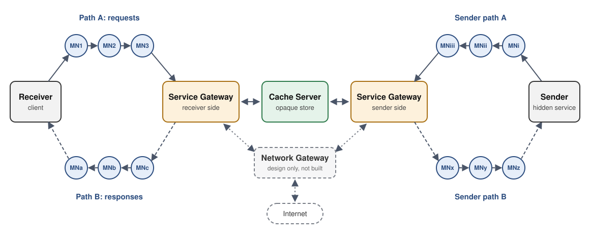

# Anon-Sec-Net (ASN)

**[hashtagRR.github.io/AnonSecNet](https://hashtagRR.github.io/AnonSecNet)**

A research prototype, written in C, of an anonymous communication system
built on separation of duties. Routing, brokering and storage run as
separate roles, so no single piece of infrastructure holds enough to link
a receiver to the service it talks to. The repository ships the
prototype, a matched single-path onion-routing baseline built on the
same crypto library and testbed, and the measurement and attack-simulation code used to
test the design.

> **Research code.** ASN exists to study a design question. It has no
> directory authorities, pins node keys trust-on-first-use, and has only
> been run on a single host. Do not use it to protect real traffic. See
> [Known limitations](#known-limitations).

---

## The idea

In onion routing, the relays that carry a circuit are also the parties
whose collusion de-anonymises it. ASN asks what happens if you pull those
duties apart and hand each one to a different operator:

| Role | Duty | What it sees | What it never sees |
|---|---|---|---|
| **Mix node** | Relays fixed-size Sphinx packets, one hop at a time | Previous and next hop, its own per-session hop key | Endpoints, payload, the other path |
| **Gateway** (receiver side, sender side) | Terminates a party's two paths, brokers requests | The request type and content key | The network address of the party behind the paths |
| **Cache** | Stores signed ciphertext, relays the content-key handshake; reachable only from gateways | Opaque blobs under lookup keys | Plaintext, and any party's address |
| **Receiver / Sender** | End points | Their own traffic | Each other's location |

Every party reaches its gateway over **two independently routed paths**:
path A carries requests out, path B carries responses back on a
pre-built return header. Content is encrypted end to end under a key the
Receiver and Sender agree on at request time, relayed through the cache,
and signed by the Sender, so neither gateway nor the cache can read or
alter it undetected.

<p align="center"></p>

In the prototype both gateway roles run in one `service_gateway` process
and all nodes run on one host; the roles are separated in the protocol,
so each could be given to a different operator.

---

## What the evaluation found

The repository includes the scripts behind each of these results, and
reports negative results alongside positive ones. Exact commands are in
[`ASN/eval2/README.md`](ASN/eval2/README.md).

**Compromise.** Linking a Receiver to a service needs four compromised
positions (`f^4`, entry and exit of one path, the receiver-side gateway
and the cache), against `f^3` for a Tor onion service. All of that margin
comes from role separation. Dual paths alone add nothing here: an
adversary holding one path's entry and exit already has routing-level
linkage (`f^2`). The margin is also fragile. At `f = 0.1` it disappears
once operator correlation passes about `rho = 0.01`.

**Flow correlation.** Against the plain build, a passive correlator
reaches a true positive rate of 0.998 to 1.000 at a false positive rate
of 1e-3, the same as against the single-path baseline. Splitting a
session over two paths with forwarded cover traffic does not by itself
resist correlation.

**Hardening.** Two optional build modes change that picture:

- *Shared-clock dispatch with per-hop mixing delay* (`make hardened`)
  lowers detection for most correlators, down to TPR 0.006 for a
  sequence correlator that was at ceiling on the plain build.
- *Per-hop decoy termination with batch mixing* (`ASN_HOP_DECOY`) cuts
  detection by a GRU correlator from 100% to 28.5% at FPR 1e-3.

**Cover traffic.** Load-adaptive cover ("real traffic takes precedence")
leaks activity level once real load passes about 1.5 times the cover
ceiling (classifier AUC 1.0 by 60% load). Constant-rate cover stays at
chance.

---

## Performance against the onion-routing baseline

Measured on the live C binaries over loopback. Absolute numbers depend
on hardware; the shape of each comparison is what reproduces. Data and
machine specs are in [`results/`](results/README.md).

| Metric | ASN | Tor-equivalent |
|---|---|---|
| Path construction, mean of 1,000 | 6.32 ms (8 handshakes) | 0.83 ms (3 handshakes) |
| Per-hop packet processing | about 5.0 us (constant-cost AES-CTR blinding) | AES-GCM decrypt and re-encrypt |
| Aggregate throughput, 1 to 200 sessions (16 vCPU) | 94.2 to 8,878.7 kbps | 82.2 to 11,713.4 kbps |
| Live GET with content handshake (n = 12) | 1.46 s mean; 3.15 s with 50 ms per-hop mixing | n/a |
| Sustained retrieval, 50 to 200 concurrent sessions | 7.66 to 7.78 GET/s, 100% completion | n/a |

---

## Quickstart

Requirements: GCC, Make, OpenSSL development headers (`libssl-dev` on
Debian and Ubuntu, `openssl-devel` on Fedora), Python 3.8 or newer.

```bash
git clone https://github.com/hashtagRR/AnonSecNet.git
cd AnonSecNet/ASN && make nodes

# Start 100 pool mix nodes, the sender-path mix nodes, gateway and cache
cd ../tests/ASN && ./start_nodes_pool.sh
```

Publish a value as the Sender, and **leave this process running**; it has
to answer the Receiver's key handshake:

```bash
cd ../../ASN && ./sender.exe
> PUT mykey hello
```

Fetch it as the Receiver from a second terminal:

```bash
cd AnonSecNet/ASN && ./client.exe
> GET mykey
Response (5 bytes, signature verified, confidentiality-protected): hello
> quit
```

Stop everything with `tests/ASN/stop_nodes_pool.sh`. The full
walkthrough, including payload size limits and how to clear persisted
guard state between runs, is in [`ASN/README.md`](ASN/README.md#running).

To run the attack simulations (no live network needed):

```bash
cd ASN/eval2
python3 -m venv .venv && .venv/bin/pip install -r requirements.txt
.venv/bin/python scripts/asn_correlated_disclosure.py --sessions 20000 --seed 20260710 --out-dir .
```

---

## Build variants

| Target | Adds |
|---|---|
| `make nodes` | Plain build: Sphinx forwarding, bidirectional cover traffic at a per-client rate tier |
| `make hardened` | `ASN_LOOPIX_MIXING`: shared fixed-rate dispatch clock plus exponential per-hop mixing delay |
| `make poolmix` | `ASN_POOL_MIXING`: batch mixing at each hop instead of per-packet delay |
| `make hopdecoy` | `ASN_HOP_DECOY`: decoys terminated at each hop; combines with the two above (`hopdecoy_hardened`, `hopdecoy_poolmix`) |
| `make instrumented` | Timing and bandwidth probes used for the benchmarks |

---

## Repository layout

```
ASN/                  the prototype
  common/             crypto (P-256 ECDHE, ECDSA, AES-GCM, AES-CTR, HKDF), Sphinx packets, node pool
  mix_node/           relay: EXTEND, DATA, RETURN, COVER
  gateway/            service gateway and cache server
  client/  sender/    Receiver and Sender
  eval2/              attack simulations: disclosure models, flow correlation, cover leakage
  scripts/            plotting for the live benchmarks
TOR-equivalent/       single-path onion-routing baseline with the same crypto library and testbed
tests/                instrumented node builds and benchmark sweep drivers
results/              curated benchmark data with machine specs
docs/                 project page and figures
```

## Documentation

| README | Covers |
|---|---|
| [`ASN/README.md`](ASN/README.md) | Topology, build, step-by-step run, packet format, configuration constants, troubleshooting. **Start here.** |
| [`ASN/eval2/README.md`](ASN/eval2/README.md) | Every attack simulation, its exact command and its result |
| [`ASN/eval2/dcf_adapter/README.md`](ASN/eval2/dcf_adapter/README.md) | DeepCoFFEA baseline adapter and its Docker environment |
| [`TOR-equivalent/README.md`](TOR-equivalent/README.md) | The baseline: design differences from ASN, build and run |
| [`tests/ASN/README.md`](tests/ASN/README.md), [`tests/TOR/README.md`](tests/TOR/README.md) | Instrumented builds and benchmark sweeps |
| [`results/README.md`](results/README.md) | Benchmark data, the machine each file was measured on, and how to regenerate it |

---

## Known limitations

- **Trust bootstrapping.** Node identity keys are pinned
  trust-on-first-use against a synthetic consensus. There are no
  directory authorities, so the first contact with a node is unverified.
- **Static guards and sender paths.** Receivers draw paths from a
  100-node weighted pool with persistent guard sets; the Sender still
  uses fixed sender-path nodes.
- **Cache access control.** The cache server binds to loopback and has
  no application-layer authentication.
- **Small payloads.** A packet carries at most 463 bytes of application
  data, and the content handshake uses part of that. Keep test values
  short.
- **Single host.** All results come from loopback testbeds. There is no
  wide-area evaluation.
- **Portability layer.** The code started on Windows and runs on Linux
  through `common/posix_compat.h`, which is why binaries keep the `.exe`
  suffix.

## Related

[AnonTestLab](https://github.com/hashtagRR/AnonTestLab) grew out of this
project: a general emulator for running controlled experiments on
anonymity network designs, including multipath splitting, mixing and
cover traffic. Use it to compare designs; use ASN to study this one in C.

---

## Licence

Copyright (C) 2026 the Anon-Sec-Net contributors.

This program is free software: you can redistribute it and/or modify it
under the terms of the GNU General Public License as published by the Free
Software Foundation, either version 3 of the License, or (at your option)
any later version. It is distributed in the hope that it will be useful,
but WITHOUT ANY WARRANTY; without even the implied warranty of
MERCHANTABILITY or FITNESS FOR A PARTICULAR PURPOSE. See [`LICENSE`](LICENSE)
for the full text.

Some files in `ASN/eval2/dcf_adapter/` are copied or adapted from
DeepCoFFEA (Oh et al., IEEE S&P 2022) and remain under its MIT licence; see
[`ASN/eval2/dcf_adapter/README.md`](ASN/eval2/dcf_adapter/README.md#licence).
